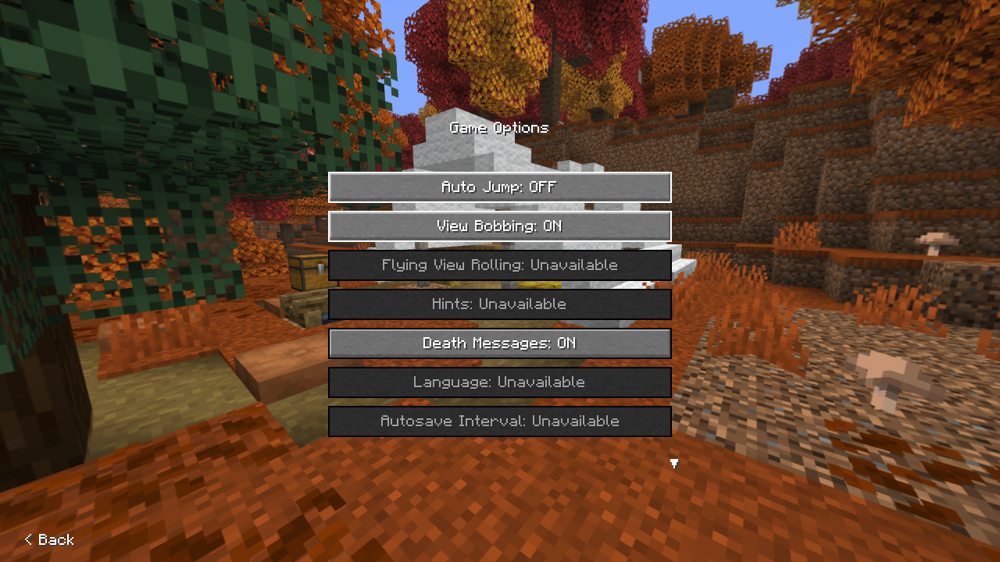

# Legacy Horizon

A Horizon-native port of Legacy4J, with GUI parity as the first milestone.

## For Claude and other contributors

Read [AGENT-README.md](AGENT-README.md) before continuing the port. It records
the owner's visual requirements, source research, native API workflow,
Horizon MCP checks, screenshot evidence and GitHub publishing conventions.
The [issues README](github%20issues/README.md) explains duplicate checks,
report formatting, AI attribution, follow-ups and the existing issue numbers.
Use the [port progress checklist](#port-progress-checklist) to track work and
[GAMEPLAY-STATUS.md](GAMEPLAY-STATUS.md) for the recorded implementation/test
evidence. Update them after each implementation session; do not infer
completion from the presence of a menu or experiment.

Settings and other button-list pages have a clear background over the
panorama: no white/gray card, border or dark backing behind the button group.
The buttons themselves retain their normal texture and focus treatment.

Current clear-background capture (disabled rows still represent unfinished work):

## Gameplay work

The native build now ports Legacy4J's axial controller movement (25% dead
zone), optional smooth input, and right-stick camera curve (34% dead zone,
squared response, source sensitivity scaling and spyglass slowdown). Movement
defaults to Horizon's normal shaping on remote servers. Existing Horizon
gameplay button mappings remain in use: this is not the full Legacy controller
preset, auto-aim, gyro or contextual inventory interaction port.

Natural-spawn quotas are available separately through
`/gamerule legacy:natural_mobcap_limits true` (off by default).
`/legacy_mobcaps` reports the loaded population and active creature gate.
The switch applies source bucket/type limits to supported natural spawn
checks and temporarily lifts the vanilla Overworld creature cap; turning it
off restores the previous numeric cap. It does not remove existing mobs.
Breeding, manual spawning, placed entities and animal despawn/protection are
unfinished, and Horizon's category scheduling remains in use. This is not
the full Legacy mob-cap gamerule.

Creative-flight and elytra physics remain unchanged. Native inner movement
replacement attempts were refused by the pinned function index; preparation
and evidence are in `research/native-flight/` and issue 15. Potion-cauldron
preparation compiled but was rejected at startup because a mod block entity
cannot own vanilla water cauldrons. That experiment is archived and excluded
from the runnable build; see `research/potion-cauldron/` and issue 17.

See [GAMEPLAY-STATUS.md](GAMEPLAY-STATUS.md) for tested behavior and remaining
work. This project has not reached full GUI or gameplay parity.

## Current GUI slice

- Uses the current flat Horizon native-mod project format.
- Carries Legacy4J's original assets and data at the package root.
- Replaces the Horizon title drawing with Legacy4J's exact 225x20 button
  geometry, five-pixel spacing, labels, hover state and keyboard focus. The
  title and plain Help/Controls/Settings lists stay directly over the panorama;
  button-list pages, including settings and skin options, stay clear too.
- Implements the title, Play Game, Leaderboards, Help & Options, Controls,
  Settings, Store, Change Skin, Credits and Exit-confirmation menu hierarchy.
- Play Game now uses Legacy4J's 300-pixel-wide panel, recessed list area and
  joined Load/Create/Join tabs, with pointer and keyboard tab navigation.
  Its world list and row actions still require upstream title-state APIs;
  Create/Join rows are disabled scaffolding.
- Implements the title-side Mouse Settings, Key Binds, Controller, Game
  Options, Audio, Graphics, User Interface, Reset Settings and store-category
  pages, including their scrolling and parent navigation.
- Reads actual supported mouse/input options, key bindings, view bobbing and
  master volume. Native settings adapters now apply/save mouse X/Y inversion,
  discrete scrolling, auto jump, view bobbing and controller Invert Look.
  Other vanilla values remain read-only; unsupported option rows are explicitly
  disabled instead of displaying invented defaults.
- Cave and minecart sound switches work and save across restarts. Legacy
  elytra sound uses the original volume cap of 0.8 and fixed pitch of 1.0 on
  both starts and live updates. Preferences live in `config/legacy/audio.json`.
  This is a partial audio port; music fades and the full Legacy audio system
  remain unported.
- User Interface → Display Hand now hides both first-person hands and held
  items, matching Legacy4J's `GameRendererMixin`. It saves separately in
  `config/legacy/interface.json`; world/HUD rendering remains independent.
- Display HUD, Display Game Messages, Death Messages and Announce Advancements
  now work and save in the same file. Message filters use translation-component
  keys and preserve player chat. Display HUD also controls the block outline.
- Controller D-pad/stick navigation, A/confirm, B/back and bumper tab changes
  now reach the replacement title pages through native adapters. Exit Game's
  confirmation now performs Horizon's normal graceful shutdown.
- Implements the valid 43-entry How To Play index. Its articles are read from
  Legacy4J's original UI-definition JSON, translated through Horizon's active
  language resources, formatting-cleaned, wrapped and scrollable.
- How To Play's list and article reader have no backing panel: their spaces
  stay clear over the panorama, as requested by the project owner.
- Uses Legacy4J's translation keys for the title hierarchy and every How To
  Play title, with explicit Legacy wording where the original relies on the
  separately enabled Legacy Resources pack.
- Supports mouse and keyboard navigation, including wheel navigation in the
  How To index, and plays Horizon's normal UI button sound for activations and
  help-page changes.
- Replaces Nether/End travel and same-dimension respawn transitions with
  Legacy4J's translated entering/leaving/respawning header geometry and
  animated eight-block loading indicator.
- Adds a live crafting recipe browser only beside crafting-table screens.
  Personal inventory crafting remains unchanged. It reads Horizon's current crafting recipes, draws
  their real result and ingredient items, supports pointer, wheel and keyboard
  selection. Recipe placement is wired to the public recipe API, but the tested
  crafting-table call was refused; placement remains incomplete pending diagnosis.
- Crafting category tabs now filter Building, Redstone, Equipment and
  Miscellaneous recipes. Title pages have a clickable Back hint. World/container
  panels use light bevels, button-list backgrounds stay clear, and exit/reset dialogs
  show translated confirmation messages with unavailable actions disabled.
- The side browser requires 164 GUI pixels to the left of the stock inventory;
  at larger GUI scales it shows a visible scale hint instead of covering slots.
- Ports the Legacy credits roll from the original credits JSON: combined
  resource credits, 18-pixel line spacing, enlarged section headings, yellow
  names, accelerated scrolling and looping. The original background and fade
  sprites are attempted; issue 1 still prevents their display in the pinned
  nightly, so its black fallback is not artwork parity.
- Targets the Nov 19 Horizon nightly at `5ef7734` (moved from `0b14f8a`, see
  GAMEPLAY-STATUS.md) and its matching horizon-mixins revision.

Menu destinations that require Horizon-owned behavior remain safely inert.
Clicks are consumed so an invisible stock button cannot run the wrong action.
The exact public-API boundaries are documented as ready-to-post reports in
[`github issues`](github%20issues/):

1. bundled title GUI textures;
2. opening a mod-owned screen at the title;
3. opening Horizon's built-in title/options screens;
4. graceful client quit;
5. GUI player/skin preview;
6. active input-glyph drawing;
7. replacement vanilla container slot layouts/hitboxes;
8. validated vanilla client-option writes;
9. controller navigation/activation for mod-drawn screens;
10. book and sign overlay render/input hooks;
11. closing world-save screen drawing;
12. distinguishing respawn from login/other dimension transitions.
13. reading Horizon's active, resource-pack-aware title splash from a
    replacement title renderer.
14. native client-tick recipe placement refusing an open crafting table:
    [#18799](https://github.com/horizon-rust/horizon/issues/18799).
15. collision-aware local creative-flight movement and takeoff/landing rules:
    [#18811](https://github.com/horizon-rust/horizon/issues/18811).
16. elytra camera banking requires camera-pose roll, already requested in
    [#18694](https://github.com/horizon-rust/horizon/issues/18694); no duplicate filed.
17. saved/synced potion state on vanilla cauldrons:
    [#19095](https://github.com/horizon-rust/horizon/issues/19095).
18. cancellable animal love-mode entry for breeding quotas:
    [#19105](https://github.com/horizon-rust/horizon/issues/19105).
19. controller-axis processing hooks (working native fallback included):
    [#19106](https://github.com/horizon-rust/horizon/issues/19106).

Issues 1-12 were posted by the project owner. Issue 13 was checked for an
existing report and posted with GitHub CLI as
[`#18655`](https://github.com/horizon-rust/horizon/issues/18655). Every report
also has a matching local Markdown copy.

Issue 4 is closed and the port now implements graceful quit natively. Issue 9
has a working native adapter for title-menu navigation; it is not a full
controller port. Other title actions, custom art, player preview, vanilla
settings sliders/key-binding writes and changed container layouts remain unfinished. In
particular, the crafting browser renders and selects recipes,
but it stays beside Horizon's stock inventory slots until issue 7's slot-layout
API exists; moving those live slots into Legacy4J's 348x215 crafting panel is
not safe with the current API.

## Port progress checklist

### Progress tracking rules

- `[ ]` Not started
- `[~]` Work in progress
- `[x]` Completed and tested
- `[!]` Blocked by missing APIs or technical limitations
- `[?]` Needs investigation

Update this checklist after every implementation session.

Do not mark a feature completed until it works in-game and has been tested.
Do not mark a feature completed simply because code has been written.

Prefer implementing features through Horizon's modding API.

The statuses below are based on the current implementation and recorded
Horizon MCP evidence in [GAMEPLAY-STATUS.md](GAMEPLAY-STATUS.md). Existing
stock Horizon behavior, static menu placeholders and disabled experiments do
not count as completed Legacy4J ports. A completed subfeature does not mean
the surrounding screen has full visual parity. Partial implementations stay
`[~]` even when one part needs an API change. `[!]` records a known boundary
on the pinned target, not a claim that every possible approach is impossible.
API numbers refer to the local [issue ledger](github%20issues/README.md#existing-report-ledger).
Items without recorded implementation are left `[ ]`; uncertain compatibility
or verification is `[?]`. Preserve the owner's clear button-list backgrounds
and table-only crafting scope while working through this list.

### 1. Main Menu and Navigation

- [~] Legacy Console-style main menu — Navigation/layout are partial; artwork and some actions remain unfinished.
- [~] Legacy title screen layout — Source button geometry is implemented; full visual parity is pending.
- [~] Legacy menu background — Panorama/fallback drawing works; bundled Legacy artwork is blocked by API 01.
- [!] Legacy button textures — Bundled texture lookup: API 01.
- [ ] Legacy menu animations
- [~] Legacy selection highlights — Native hover/focus works; exact Legacy highlight artwork is pending.
- [~] Play Game menu — Load/Create/Join panel and navigation; world/server actions remain incomplete.
- [!] Singleplayer world selection — Title-state/action surfaces: APIs 02–03.
- [~] Multiplayer menu — Join tab scaffolding; connection/server flows are unfinished.
- [~] Settings menu — Menu hierarchy and selected saved toggles work; many settings remain unfinished.
- [~] Help & Options menu — Navigation works; skin and other destinations remain partial.
- [x] How To Play menu — 43-entry index and article reader exercised in Horizon MCP; clear background.
- [~] Change Skin menu — Clear button-list scaffolding; skin actions/preview are unfinished.
- [ ] Mods menu
- [ ] Patch/Update Notes menu
- [x] Exit Game confirmation — Confirmed native graceful shutdown and successful client exit in Horizon MCP.
- [~] Controller navigation across menus — Replacement title pages work; not all in-world menus are ported.
- [!] Controller button prompts — Active input glyph drawing: API 06.
- [~] Legacy-style confirmation dialogs — Exit flow works; reset and other actions remain incomplete.

### 2. Pause Menu

- [~] Legacy pause menu layout — Source column, labels and disabled rows tested; Leaderboards/Advancements/Save destinations missing.
- [x] Resume Game button — Mouse and keyboard tested; closes as Escape does.
- [!] Help & Options button — Disabled: no pinned way to open owned/built-in pages over the pause screen.
- [!] Settings access — Reached through Help & Options; same boundary.
- [ ] Player list
- [ ] Multiplayer options
- [~] Exit and Save functionality — Exit confirmation, leave-to-title and the saved world tested; Save Game is disabled.
- [~] Legacy pause screen background — Stock menu blur only; Legacy4J's default background not compared.
- [~] Controller navigation — Gamepad buttons are routed to the Legacy menu on the pause screen; not tested with a controller.

### 3. HUD

- [~] Legacy HUD layout — Hotbar, health/armor/food rows and XP bar at Legacy4J's scale and distance; opacity and tooltips remain.
- [x] Legacy hotbar positioning — Scaled about the bottom centre and raised; items, counts and 3D blocks tested.
- [~] HUD scaling — Default HUD size (1.5×) only; no size setting or SD/FHD modes.
- [ ] HUD opacity adjustment
- [~] HUD distance from screen bottom — Default distance only; the control-tooltip gap is left out (API 06).
- [~] Legacy health display — Stock hearts at Legacy4J's scale and position.
- [~] Legacy hunger display — Stock food row at Legacy4J's scale and position.
- [~] Legacy armor display — Stock armor row at Legacy4J's scale and position.
- [~] Legacy experience bar — Stock bar and level at Legacy4J's scale and position.
- [ ] Legacy crosshair
- [ ] Legacy item tooltips
- [~] Item name display — Lifted above the larger rows at its stock size; Legacy4J's tooltip lines not ported.
- [!] Paper doll player preview — GUI player rendering: API 05.
- [!] Paper doll animations — Depends on the missing GUI player-preview surface, API 05.
- [ ] Auto-save indicator
- [!] Controller action prompts — Active input glyph drawing: API 06.
- [ ] Legacy-style status effects display

### 4. Inventory

- [!] Legacy survival inventory — Replacement live slot layout/hitboxes: API 07; stock inventory remains.
- [ ] Legacy creative inventory
- [ ] Legacy inventory textures
- [!] Legacy inventory slot layout — Replacement live slot layout/hitboxes: API 07.
- [ ] Legacy inventory navigation
- [ ] Controller cursor movement
- [ ] Controller item selection
- [ ] Quick item transfer
- [ ] Item swapping
- [ ] Item splitting
- [ ] Item dropping
- [ ] Inventory tooltips
- [ ] Creative inventory tabs
- [ ] Creative item categories
- [!] Inventory player preview — GUI player rendering: API 05.

### 5. Crafting

- [~] Legacy crafting interface — Working side browser, not the full source slot layout; API 07.
- [~] Classic crafting menu — Stock grid plus side browser; no complete Legacy grid replacement.
- [~] Recipe category tabs — Four tested live filters, not the complete source category/group system.
- [x] Recipe selection — Pointer, wheel and keyboard selection tested in the current side browser.
- [ ] Craftable recipe indicators
- [ ] Uncraftable recipe indicators
- [!] Automatic ingredient placement — place_recipe refused the open table: API 14.
- [ ] Automatic crafting
- [x] Recipe previews — Real result and ingredient previews observed in the side browser.
- [ ] Recipe ingredient tooltips
- [~] Crafting table interface — Browser is table-only; Legacy panel/slot replacement is unfinished.
- [ ] Player inventory crafting — Intentionally left unchanged; do not apply the table layout to it.
- [ ] Controller crafting navigation

### 6. Container and Utility Screens

- [!] Chest interface — Live slot layout/hitboxes: API 07.
- [!] Large chest interface — Live slot layout/hitboxes: API 07.
- [!] Furnace interface — Live slot layout/hitboxes: API 07.
- [!] Blast furnace interface — Live slot layout/hitboxes: API 07.
- [!] Smoker interface — Live slot layout/hitboxes: API 07.
- [!] Brewing stand interface — Live slot layout/hitboxes: API 07.
- [!] Enchanting table interface — Live slot layout/hitboxes: API 07.
- [!] Anvil interface — Live slot layout/hitboxes: API 07.
- [!] Smithing table interface — Live slot layout/hitboxes: API 07.
- [!] Grindstone interface — Live slot layout/hitboxes: API 07.
- [!] Stonecutter interface — Live slot layout/hitboxes: API 07.
- [!] Loom interface — Live slot layout/hitboxes: API 07.
- [!] Cartography table interface — Live slot layout/hitboxes: API 07.
- [!] Beacon interface — Live slot layout/hitboxes: API 07.
- [!] Shulker box interface — Live slot layout/hitboxes: API 07.
- [!] Hopper interface — Live slot layout/hitboxes: API 07.
- [!] Dispenser interface — Live slot layout/hitboxes: API 07.
- [!] Dropper interface — Live slot layout/hitboxes: API 07.
- [!] Villager trading interface — Live slot layout/hitboxes: API 07.
- [!] Horse inventory interface — Live slot layout/hitboxes: API 07.

### 7. Controller Support

- [?] Gamepad detection — Uses Horizon detection; source-equivalent connection handling is not verified.
- [?] Xbox controller support — Virtual positional-button tests exist; physical-device parity is not verified.
- [?] PlayStation controller support — Physical-device/source parity is not verified.
- [ ] Controller button mapping
- [ ] Configurable controller bindings
- [~] Analog movement — Axial curve/dead zone tested; broader movement cases remain.
- [~] Analog camera movement — Dead zone/turn observed; exact live rate, scope and polling parity remain.
- [~] Camera sensitivity — Curve uses the native setting; the custom sensitivity slider is unfinished.
- [~] Controller deadzone settings — Source constants are used/displayed; editable controls are unfinished.
- [ ] Controller inventory navigation
- [~] Controller menu navigation — D-pad/stick/confirm/back exercised on replacement title pages.
- [?] Controller vibration — No Legacy-specific haptic implementation/device verification recorded.
- [!] Context-sensitive button prompts — Active input glyph drawing: API 06.
- [ ] Controller hotbar navigation
- [ ] Controller crafting controls
- [?] Controller disconnect handling — Legacy-equivalent behavior has not been verified.
- [?] Keyboard and controller switching — Full source-equivalent handoff behavior has not been verified.

### 8. World Creation

- [~] Legacy world creation screen — Create tab is scaffolding; creation controls/actions are not implemented.
- [ ] World naming
- [ ] Game mode selection
- [ ] Difficulty selection
- [ ] World seed entry
- [ ] World type selection
- [ ] Superflat world customization
- [ ] World generation options
- [ ] Bonus chest option
- [ ] Starting map option
- [ ] Cheats/host privileges
- [ ] Multiplayer world settings
- [ ] Online game options
- [ ] World templates
- [ ] Tutorial world selection
- [ ] Resource pack configuration

### 9. World Management

- [!] Legacy world selection screen — World/title state and actions: APIs 02–03.
- [!] World preview information — World/title state surface: APIs 02–03.
- [ ] World settings
- [ ] World deletion
- [ ] World duplication
- [ ] World renaming
- [~] World loading interface — Dimension/respawn transitions exist; initial world-load parity is unfinished.
- [!] World saving interface — Closing world-save draw hook: API 11.
- [ ] Save indicator
- [ ] World-specific settings
- [ ] World-specific resource packs

### 10. Settings and Options

- [~] Legacy settings layout — Clear button lists and scrolling work; exact source controls remain incomplete.
- [~] Game options — Selected native and mod-owned toggles work; remaining rows are unfinished.
- [~] Graphics options — Read-only/scaffold page; no complete source settings implementation.
- [~] Audio options — Cave/cart switches and elytra sound policy work; music/master sliders remain.
- [~] Controller options — Invert Look and Smooth Movement work; other controls remain unfinished.
- [~] User interface options — HUD/hand/message switches work; scaling, opacity and other controls remain.
- [~] Sensitivity settings — Live values are read; custom writable sliders remain unfinished.
- [x] Invert camera settings — Mouse X/Y and controller Invert Look applied, saved and verified after restart.
- [ ] HUD scaling settings
- [ ] HUD opacity settings
- [ ] Gamma settings
- [ ] Terrain fog settings
- [ ] Difficulty settings
- [ ] Accessibility settings
- [ ] Resource pack settings
- [ ] Language settings

### 11. Rendering and Visual Effects

- [~] Legacy GUI rendering — Replacement title/help/settings and crafting browser; full parity is unfinished.
- [ ] Legacy GUI lighting
- [?] Legacy font rendering — Source-equivalent font/resource behavior needs investigation.
- [!] Legacy UI textures — Bundled GUI texture lookup: API 01.
- [~] Legacy screen transitions — Dimension/respawn drawings exist; other transitions and cause handling remain.
- [ ] Legacy menu animations
- [ ] Legacy gamma shader
- [ ] Terrain fog behavior
- [~] Legacy item rendering in menus — Live recipe item drawing works; full source appearance is not verified.
- [!] Legacy entity previews — GUI entity/player rendering: API 05.
- [!] Legacy player previews — GUI player rendering: API 05.
- [ ] Legacy tooltip rendering

### 12. Gameplay Mechanics

- [!] Legacy creative flight behavior — Inner travel/speed/collision targets unavailable on the pinned build: API 15.
- [!] Legacy elytra momentum — Inner movement integration is unavailable; API 15, with camera roll separately API 16.
- [~] Legacy mob-cap behavior — Opt-in natural quotas only; breeding/manual/despawn/scheduling remain.
- [!] Legacy potion-related tweaks — Vanilla-cauldron saved block-entity ownership rejected: API 17; experiment disabled.
- [~] Legacy controller movement behavior — Source curves are partial; full gameplay mappings/interactions remain.
- [ ] Legacy interaction behavior
- [ ] Legacy inventory interaction behavior

### 13. Skins and Player Customization

- [~] Change Skin interface — Clear menu scaffolding only; not a working skin-selection system.
- [!] Skin preview — GUI skin/player preview: API 05.
- [ ] Skin selection
- [ ] Skin categories
- [!] Player model preview — GUI player preview: API 05.
- [!] Player model rotation — Depends on the missing player-preview renderer, API 05.
- [?] Skin compatibility with Java Edition — No Legacy skin-port compatibility verification recorded.
- [ ] Controller skin selection

### 14. Help and Tutorials

- [x] How To Play interface — Clear index/article interface exercised in Horizon MCP.
- [x] Tutorial categories — Valid 43-entry How To Play index implemented and tested.
- [~] Tutorial pages — Source JSON reader/translation/wrapping works; not every article has a complete live audit.
- [x] Tutorial navigation — Index and article selection/back/scroll behavior tested with mouse and keyboard.
- [!] Controller instruction prompts — Active input glyph drawing: API 06.
- [ ] Tutorial world support
- [ ] Advanced gameplay hints
- [ ] Context-sensitive hints

### 15. Resource Packs and Additional Features

- [ ] Resource Albums
- [ ] Global resource packs
- [ ] World-specific resource packs
- [!] Legacy texture compatibility — Bundled GUI textures cannot yet be drawn through the tested path: API 01.
- [?] Legacy font resources — Bundled resources alone do not prove runtime source parity.
- [~] Legacy sound resources — Partial sound behavior/filtering; full Legacy audio/resource parity is unfinished.
- [~] Legacy UI assets — Bundled material exists; runtime artwork parity is blocked in part by API 01.
- [ ] Mods screen integration
- [ ] Patch notes interface
- [?] World Host integration — Requirements and Horizon counterpart need investigation.

### 16. Multiplayer

- [~] Legacy multiplayer interface — Join-tab scaffolding only; not a complete connection flow.
- [ ] Multiplayer world options
- [ ] Player list interface
- [ ] Multiplayer pause menu
- [ ] Online game settings
- [ ] Controller-friendly multiplayer navigation
- [ ] Multiplayer compatibility testing

### 17. Horizon Integration

- [x] Horizon mod manifest — Pinned native manifest built and installed successfully.
- [x] Horizon mod initialization — Native package launched and its hooks/registrations exercised in game.
- [~] Legacy4J resource loading — Help/credits data loads; GUI artwork remains incomplete.
- [~] Legacy4J configuration storage — Implemented interface/audio/native options persist; not every source setting is ported.
- [~] Screen replacement API support — Draw-hook replacements work; opening owned title screens is API 02.
- [~] Custom GUI rendering — Several pages render; textures/previews/layouts remain incomplete.
- [~] GUI input handling — Title and browser interactions tested; full screen coverage is unfinished.
- [~] Controller input integration — Native title and movement adapters tested; broader source input remains.
- [~] Inventory screen integration — Stock container context is used; Legacy replacement slots require API 07.
- [~] Crafting screen integration — Table browser works; placement/layout remain APIs 14/07.
- [!] World creation screen integration — Public title/world actions are missing: APIs 02–03; creation port is unfinished.
- [~] HUD rendering integration — HUD/hand/outline switches work; no complete Legacy HUD layout.
- [~] Gameplay hooks integration — Natural quota subset and local controls exist; full gameplay port is unfinished.
- [?] Renderer extension support — Further renderer capabilities need investigation; not a mandate to modify core.
- [?] Compatibility with Horizon updates — Only the pinned build has recorded native validation.
- [~] Avoid unnecessary modifications to Horizon core — Ongoing constraint; the port does not ship an engine fork.
- [~] Automated compatibility tests — 23 local tests exist; no complete cross-version/feature compatibility matrix.
- [~] In-game feature verification — Recorded MCP checks cover implemented slices, not the entire checklist.

### 18. Final Verification

- [~] Main menus match Legacy4J — Geometry/navigation slices verified; artwork/actions are incomplete.
- [~] Pause menu matches Legacy4J — Button column verified; four destinations disabled, background not compared.
- [ ] HUD matches Legacy4J
- [ ] Inventory matches Legacy4J
- [~] Crafting matches Legacy4J — Browser works; source slot layout and automatic placement are unfinished.
- [~] Controller behavior matches Legacy4J — Curves/title navigation verified only in part.
- [ ] World creation matches Legacy4J
- [~] Settings match Legacy4J — Selected persisted toggles and clear lists; many controls remain unfinished.
- [~] Rendering matches Legacy4J where supported — Progress captures exist; no full visual parity audit.
- [~] Gameplay modifications work — Natural quota/controller/audio subsets; requested flight/potion work is not enabled.
- [?] Multiplayer works — No complete port-specific multiplayer verification recorded.
- [?] No critical crashes — Successful test runs are not a complete release audit; rejected experiments stay disabled.
- [?] No major visual regressions — Selected menus checked; full-screen/scale regression audit remains.
- [~] Works on supported Horizon versions — Pinned nightly launches; full feature coverage is incomplete.
- [~] All implemented features documented — Status/evidence docs exist; keep them and this checklist current after each session.

## Development

Run `cargo test --locked` for the local layout/navigation tests. Build the exact
nightly package with `horizon-launcher native-build` and test it in the
`legacy-horizon-gui-test` instance. The pinned SDK is cached in `.horizon/sdk/`,
so ordinary tests do not fetch a second copy of Horizon.

For a fresh checkout, provision the exact SDK pinned in `horizon-mod.toml`
using Horizon's native-mod tooling before running Cargo. The SDK and build
outputs are intentionally excluded from Git. See [CONTRIBUTING.md](CONTRIBUTING.md)
for current status and testing boundaries.

## Credits and licensing

This is an unfinished Rust port derived from Legacy4J by Wily and its
contributors. Original Legacy4J material retains its upstream LGPL-3.0 terms
and copyright notices; see [LICENSE-LEGACY4J.md](LICENSE-LEGACY4J.md).
The repository's existing MIT license does not relicense upstream material.
Bundled resource notices and third-party credits remain applicable.

