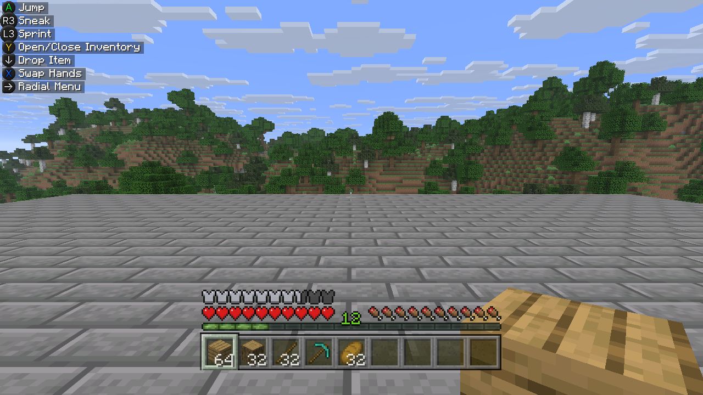
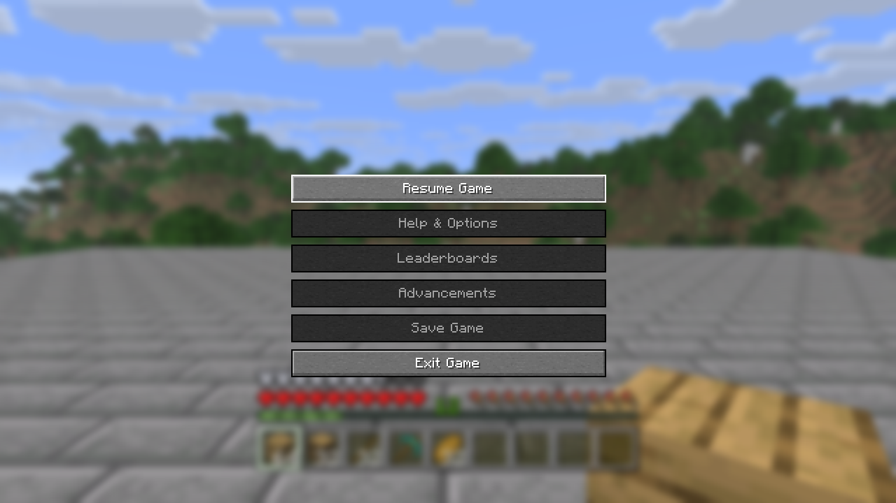

# Test the merged PR build

## Ready-to-play instance on Jacob's computer

In Horizon Launcher, select **Legacy Horizons - PR Test** in the
**Legacy Horizons** group (crafting-table icon). It is already selected.

- Press **Play** to test the title/help/settings menus.
- For the in-game HUD and pause menu, use the launcher's **Worlds** page,
  select **Legacy Horizons Demo** and press **Play** there. The replacement
  title's own world-selection flow is still unfinished.
- The demo is a separate Peaceful/Survival world with a stone-brick platform,
  crafting table, furnace, chest, materials, tools, armor and XP. None of the
  owner's existing worlds were copied or changed.
- Press **Escape** to open the Legacy pause menu. Test Resume Game, Exit Game,
  Cancel, and the final Exit Game confirmation. Confirmed exit saves the world
  and returns to the title screen.
- Gamepad confirm/back and up/down navigation were tested through Horizon
  MCP's virtual controller. Physical gamepads and multiplayer were not tested
  in this integration session.

The instance is pinned to native build `native-f037744-7009c0f7c971`, based on
Horizon Nightly 2026-11-21 `f037744a79f9982c47876f49c5a3067279f88706`.
This is a local setup, not an instance/world bundled in the Git repository.

## What was merged and checked

PRs [#1](https://github.com/Jacob0225/Legacy-Horizons/pull/1),
[#2](https://github.com/Jacob0225/Legacy-Horizons/pull/2),
[#3](https://github.com/Jacob0225/Legacy-Horizons/pull/3) and
[#4](https://github.com/Jacob0225/Legacy-Horizons/pull/4) form a stack.
They were reviewed and tested together, then merged in order with merge
commits and exact-head checks. Merged revision `331a14d` has the same tree as
the reviewed PR #4 head `7157778`.

- 35 unit tests passed against the pinned SDK in an isolated checkout.
- Native build accepted the declared patches and installed successfully on Linux.
- Live MCP inspection showed the new HUD with items/counts, armor, health,
  hunger and XP at 1280×720, GUI scale 2.
- Pause-menu Resume, confirmation Cancel/back, and confirmed Exit were tested
  with the virtual gamepad. The saved world was reopened through the launcher;
  position `[-31.5, 81, 0.5]`, survival mode and level 12 plus XP progress remained.
- The production native package was rebuilt from the merged main checkout.

Actual captures:





This remains a partial port. The pause menu's Help & Options, Leaderboards,
Advancements and Save Game destinations are disabled. Confirmed Exit saves a
single-player world; the disabled Save Game button is a separate unfinished
action. Stock controller prompts and some HUD artwork remain. See the README
checklist and `GAMEPLAY-STATUS.md` for the full limitations.

## Rebuild and standalone test notes

From the port's main folder, with the pinned nightly installed:

```sh
horizon-launcher native-build --instance legacy-horizons-pr-test --version nightly-2026-11-21-f037744 .
```

The installed native game contains the packaged mod; normal play does not
depend on the temporary review checkout. Rebuilding selects the resulting
native version for this instance without upgrading other instances.

The native package uses a registry-only lockfile. A standalone `cargo test`
against a full-source SDK may need extra generator/build dependencies and
reject that lock with `--locked`. For this review, the lock was expanded only
in the disposable checkout, all 35 tests passed, and the original package lock
was restored before checking/merging the tree. No existing registry version
was upgraded by that expansion. Do not commit a development-only lock graph
over the launcher package lock. SDK generation also writes a report under its
source tree: use a writable disposable SDK copy, not a read-only/shared cache.

The tests' first launch attempts lacked a working Linux display. Visual checks
then used a temporary isolated Weston display; these environment variables
were not saved into the user's instance. Normal launches use the desktop's
display. Test worlds, account information, build caches and SDK files are not
committed to this repository.
